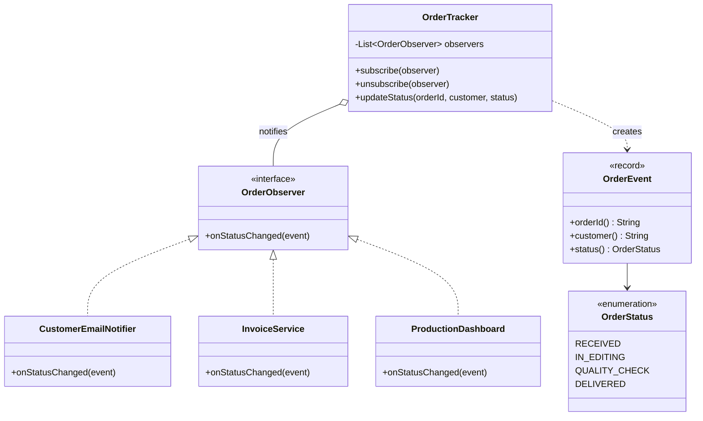
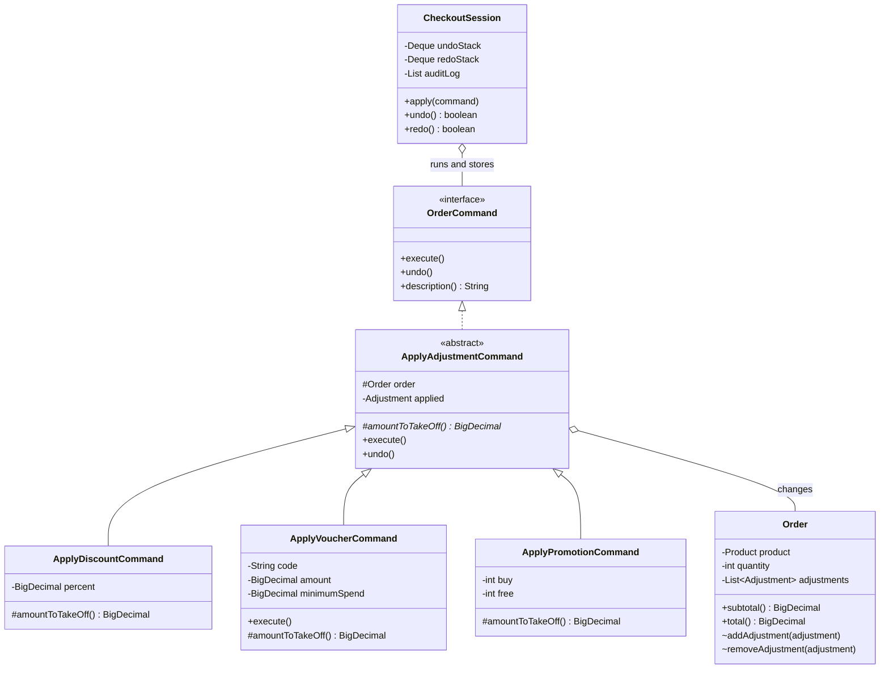

# Behavioral Pattern
1. Strategy pattern: Swap the way something is calculated without changing the code that uses it
2. Observer pattern: When one object changes, every object that subscribed to it is told automatically
3. Command pattern: Pack an action into an object, so it can be stored, logged, undone and redone

The diagrams below use [Mermaid](https://mermaid.js.org/syntax/classDiagram.html). They render on GitHub and in most Markdown previews.

How to read the arrows:

- `<|..` a class implements an interface
- `<|--` a class extends another class
- `o--` a class holds a reference to another class
- `..>` a class creates or uses another class

---

## 1. Strategy pattern

Code: `strategy/`


**How it works**

Think of a cashier with a drawer of offer cards. The cashier always rings up the order the same way. The only thing that changes is which card the customer hands over: 10% off, a 20 EUR voucher, or "buy 3, get 1 free".

- `PricingStrategy` is the offer card. It answers one question: how much comes off this order?
- Each offer is its own small class:
  - `PercentageDiscount`: a share of the order, e.g. 10% of 60 EUR = 6 EUR off.
  - `Voucher`: a fixed amount, e.g. `WELCOME20` takes 20 EUR off, but only if the order is at least 50 EUR.
  - `BuyXGetYFreePromotion`: free units, e.g. buy 3 get 1 free makes 4 photos cost the same as 3.
  - `RegularPrice`: nothing off. It is the default, so `Checkout` never has to check for `null`.
- `Checkout` is the cashier. It holds one strategy and calls `discountFor()`. It has no `if` or `switch` on the kind of offer, and the strategy can be changed at any time with `setStrategy()`.
- `Checkout` also makes sure the discount is between zero and the order subtotal, so no strategy can make a total negative.
- To add a new offer, such as "free blue sky on orders over 100 EUR", you add one class that implements `PricingStrategy`. `Checkout` and the other offers do not change. `StrategyTest.newStrategyNeedsNoChangeToCheckout` shows this.

**When to use it:** there are several ways to do the same job (pricing, sorting, routing, retry rules), and you want to choose one at runtime instead of piling up `if/else` branches.

**Strategy vs Decorator:** the `structures/decorator` example also applies a discount. A decorator **wraps** an order, so you can stack several rules (discount, then tax, then shipping). A strategy **replaces** one step: the checkout uses exactly one pricing rule at a time. Use a decorator when rules add up, and a strategy when you pick one rule from several.

---

## 2. Observer pattern

Code: `observer/`



**How it works**

Think of a newsletter. People who are interested sign up. When there is news, the publisher sends it to everyone on the list. The publisher doesn't need to know what each reader does with it, and readers can unsubscribe at any time.

- `OrderTracker` is the publisher (the "subject"). It keeps a list of observers and has `subscribe()` and `unsubscribe()`.
- When an order moves to a new status, `updateStatus()` creates an `OrderEvent` and sends it to every observer, in the order they subscribed.
- Each observer decides what to do with the event:
  - `CustomerEmailNotifier` emails the customer on every change.
  - `InvoiceService` ignores everything except `DELIVERED`, then creates an invoice.
  - `ProductionDashboard` keeps the latest status of each order.
  - The demo also subscribes a lambda that calls a client webhook on delivery. `OrderObserver` has one method, so a lambda works too.
- `OrderTracker` only knows the `OrderObserver` interface. To add something new, such as an SMS alert, you write one observer and subscribe it. The tracker does not change.
- The observer list is a `CopyOnWriteArrayList`, so an observer can unsubscribe itself while it is being notified. `ObserverTest.observerCanUnsubscribeWhileBeingNotified` checks this.

**When to use it:** one change has to trigger several unrelated reactions, and you don't want the code that makes the change to know about all of them.

**Watch out:**
- Observers run one after another in the same thread. A slow observer slows down every status update, and an observer that throws an exception stops the observers after it from being notified. Real systems often send events through a queue instead.
- An observer that is never unsubscribed stays in memory as long as the subject does.

**Where you see it:** Spring's `ApplicationEventPublisher` with `@EventListener`, and on AWS, EventBridge and SNS. Those are the same idea spread across services: HPP publishes "order complete" to EventBridge, and Auto-Job or E3 Order reacts without HPP calling them directly.

**Observer vs Strategy:** a strategy is **one** object that `Checkout` asks "how should I do this?". Observers are **many** objects that `OrderTracker` tells "this just happened". It does not wait for an answer from them.

---

## 3. Command pattern

Code: `command/`



**How it works**

Think of a restaurant order slip. The waiter writes "1 soup, no onions" on a slip and hands it to the kitchen. The slip can wait in a queue, the kitchen can cook it later, and it can be crossed out if the guest changes their mind. The request has become a thing you can hold.

The pattern has four roles:

| Role | Class | What it does |
|---|---|---|
| Command | `OrderCommand` | `execute()`, `undo()`, `description()` |
| Concrete commands | `ApplyDiscountCommand`, `ApplyVoucherCommand`, `ApplyPromotionCommand` | Each one knows how much to take off |
| Receiver | `Order` | Holds the lines taken off. Knows how to add or remove a line, not what a voucher is |
| Invoker | `CheckoutSession` | Runs commands, keeps undo/redo stacks and an audit log. Doesn't know what any command does |

- The three commands share `ApplyAdjustmentCommand`. On `execute()` it asks the subclass how much to take off, adds that line to the order and remembers it. On `undo()` it removes that exact line.
- Commands **stack**. The demo applies all three to 8 photos: 120 EUR, minus 30 for the promotion (2 free), minus 20 for the voucher, minus 10% of the remaining 70 = 63 EUR.
- Order matters. The discount is taken from the total at the moment it runs, so "voucher then 10%" gives a different result from "10% then voucher".
- `undo()` removes the last command and `redo()` puts it back. Applying a new command clears the redo list, like in a text editor.
- A voucher below its minimum spend throws in `execute()`. `CheckoutSession` only records a command after it succeeds, so a refused voucher leaves no trace in the history.

**When to use it:** you need undo/redo, an audit trail of actions, or to queue, schedule or retry actions later.

**Where you see it:** a message on SQS is a command in serialised form, and HPP machine steps work the same way. A job request is created now and executed later by another service. Spring Batch steps and `Runnable` tasks given to an `ExecutorService` are also commands.

---

## Command vs Strategy

Both examples handle the same voucher, promotion and discount, so they are easy to compare.

| | Strategy (`strategy/`) | Command (`command/`) |
|---|---|---|
| Main question | **How** should this step be calculated? | **What** action should happen, and can I take it back? |
| What the object holds | Only a rule: "10% off", "buy 3 get 1" | A rule **plus** its target (`Order`) and what it changed (`applied`) |
| Who decides when it runs | `Checkout` calls it whenever it prices an order | `CheckoutSession` runs it once, when asked |
| How many at once | One at a time. `setStrategy()` replaces the previous one | Many. Each `apply()` adds one more line |
| Changes the order? | No. It only returns a number; `Checkout` does the rest | Yes. `execute()` adds a line to the `Order` |
| Undo / redo | Not needed. Pick a different strategy instead | Built in: `undo()` reverses exactly what `execute()` did |
| History / audit | None | `CheckoutSession.getAuditLog()` |
| Same input twice | Same answer every time | Result depends on what was applied before |

Same offers, different results:

```text
Strategy, 4 photos:  pick ONE offer        -> 60 EUR, 54 EUR (10%), 40 EUR (voucher) or 45 EUR (promotion)
Command,  8 photos:  promotion + voucher + 10%, step by step -> 120 -> 90 -> 70 -> 63 EUR, then undo -> 70 EUR
```

**How to choose:**

- Use **Strategy** when there are several ways to calculate one thing and you pick one, e.g. the pricing rule for a customer contract.
- Use **Command** when the user performs actions that must be remembered, undone or replayed, e.g. a customer adding and removing vouchers in a cart, with a record of what happened.

**They work well together.** A command can carry a strategy: an `ApplyOfferCommand(order, pricingStrategy)` would use the strategy to work out *how much* and the command to *apply it, log it and undo it*.
