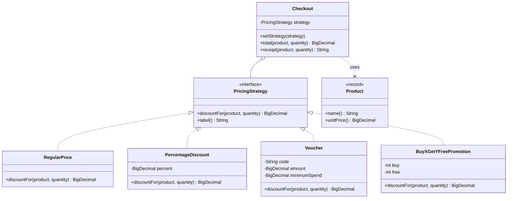

# Behavioral Pattern
1. Strategy pattern: Swap the way something is calculated without changing the code that uses it

The diagrams below use [Mermaid](https://mermaid.js.org/syntax/classDiagram.html). They render on GitHub and in most Markdown previews.

How to read the arrows:

- `<|..` a class implements an interface
- `<|--` a class extends another class
- `o--` a class holds a reference to another class
- `..>` a class creates or uses another class

---

## 1. Strategy pattern

Code: `strategy/`

**How it works**

Think of a cashier with a drawer of offer cards. The cashier always rings up the order the same way. The only thing that changes is which card the customer hands over: 10% off, a 20 EUR voucher, or "buy 3, get 1 free".

- `PricingStrategy` is the offer card. It answers one question: how much comes off this order?
- Each offer is its own small class:
  - `PercentageDiscount`: a share of the order, e.g. 10% of 60 EUR = 6 EUR off.
  - `Voucher`: a fixed amount, e.g. `WELCOME20` takes 20 EUR off, but only if the order is at least 50 EUR.
  - `BuyXGetYFreePromotion`: free units, e.g. buy 3 get 1 free makes 4 photos cost the same as 3.
  - `RegularPrice`: nothing off. It is the default, so `Checkout` never has to check for `null`.
- `Checkout` is the cashier. It holds one strategy and calls `discountFor()`. It has no `if` or `switch` on the kind of offer, and the strategy can be changed at any time with `setStrategy()`.
- `Checkout` also makes sure the discount is between zero and the order subtotal, so no strategy can make a total negative.
- To add a new offer, such as "free blue sky on orders over 100 EUR", you add one class that implements `PricingStrategy`. `Checkout` and the other offers do not change. `StrategyTest.newStrategyNeedsNoChangeToCheckout` shows this.

**When to use it:** there are several ways to do the same job (pricing, sorting, routing, retry rules), and you want to choose one at runtime instead of piling up `if/else` branches.

**Strategy vs Decorator:** the `structures/decorator` example also applies a discount. A decorator **wraps** an order, so you can stack several rules (discount, then tax, then shipping). A strategy **replaces** one step: the checkout uses exactly one pricing rule at a time. Use a decorator when rules add up, and a strategy when you pick one rule from several.
