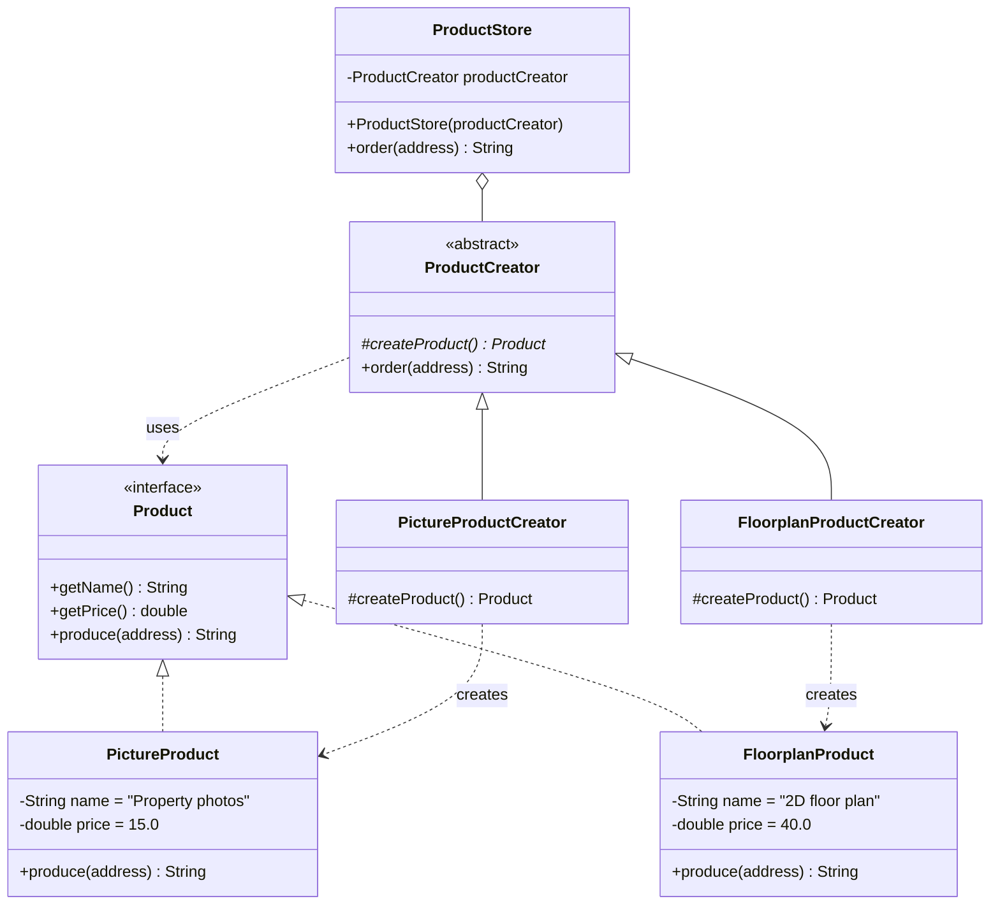
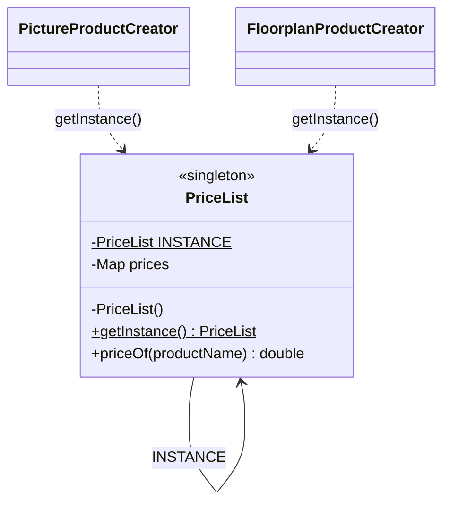

# Creation Pattern
1. Builder pattern: Support to build a complex object, building the object step by step
2. Factory method pattern: Flexible to build the object and easy to extends
3. Singleton pattern: Only one instance global

The diagrams below use [Mermaid](https://mermaid.js.org/syntax/classDiagram.html). They render on GitHub and in most Markdown previews.

How to read the arrows:
- `<|..` a class implements an interface
- `<|--` a class extends another class
- `o--` a class holds a reference to another class
- `..>` a class creates or uses another class

---

## 1. Builder pattern

Code: `builder/`

```mermaid
classDiagram
    class Product {
        <<interface>>
        +getName() String
        +getPrice() double
        +produce(address) String
    }

    class PictureProduct {
        -int photoCount
        -boolean blueSky
        -boolean windowDetails
        -boolean straightening
        -double price
        -PictureProduct(builder)
        +builder()$ PictureProductBuilder
        +produce(address) String
    }

    class PictureProductBuilder {
        -int photoCount = 10
        -boolean blueSky
        -boolean windowDetails
        -boolean straightening
        +photoCount(int) PictureProductBuilder
        +blueSky() PictureProductBuilder
        +windowDetails() PictureProductBuilder
        +straightening() PictureProductBuilder
        +build() PictureProduct
    }

    class FloorplanProduct {
        -int floors
        -boolean threeD
        -boolean furniture
        -boolean measurements
        -double price
        -FloorplanProduct(builder)
        +builder()$ FloorplanProductBuilder
        +produce(address) String
    }

    class FloorplanProductBuilder {
        -int floors = 1
        -boolean threeD
        -boolean furniture
        -boolean measurements
        +floors(int) FloorplanProductBuilder
        +threeD() FloorplanProductBuilder
        +furniture() FloorplanProductBuilder
        +measurements() FloorplanProductBuilder
        +build() FloorplanProduct
    }

    class BuilderDemo {
        +main(args)$
    }

    Product <|.. PictureProduct
    Product <|.. FloorplanProduct
    PictureProduct +-- PictureProductBuilder : nested class
    FloorplanProduct +-- FloorplanProductBuilder : nested class
    PictureProductBuilder ..> PictureProduct : build()
    FloorplanProductBuilder ..> FloorplanProduct : build()
    BuilderDemo ..> PictureProductBuilder : uses
    BuilderDemo ..> FloorplanProductBuilder : uses
```

`PictureProductBuilder` and `FloorplanProductBuilder` are the nested `PictureProduct.Builder` and `FloorplanProduct.Builder` classes in the code. Mermaid does not allow dots in class names.

**How it works**

Think of ordering a pizza. You don't hand the chef a list of ten values in a fixed order. You say "large, extra cheese, no onions", and the chef makes it once you're done.

- The caller gets a builder with `PictureProduct.builder()`.
- The caller adds only the options it wants: `.photoCount(25).blueSky().windowDetails()`. Each call returns the same builder, so the calls chain.
- `.build()` checks the choices (for example, 1 to 100 photos) and only then creates the product.
- The product's constructor is private and its fields are `final`. The only way to get a product is through `build()`, so every product is valid and cannot change afterwards.

**When to use it:** an object has many optional parts, or you want to stop people from creating it in a half-filled or invalid state.

---

## 2. Factory method pattern

Code: `factory/`



**How it works**

Think of a restaurant with several kitchens. The ordering process is the same for every dish (take the order, cook, serve), but each kitchen decides what it actually cooks.

- `ProductCreator` holds the shared logic in `order()`. It calls `createProduct()` but does not know which product comes back. It only sees the `Product` interface.
- `createProduct()` is the "factory method". It is abstract, so each subclass fills it in: `PictureProductCreator` returns a `PictureProduct`, `FloorplanProductCreator` returns a `FloorplanProduct`.
- `ProductStore` is given a creator and passes orders to it. It never uses `new PictureProduct()` itself.
- To add a new product, such as a video, you add `VideoProduct` and `VideoProductCreator`. None of the existing classes change.

**When to use it:** the shared steps stay the same but the exact object to create varies, and you want to add new types without editing working code.

**Builder vs Factory method:** the factory decides *which* product to make. The builder lets the caller decide *how* one product is put together.

---

## 3. Singleton pattern

Code: not in this package yet. The sample below is a suggestion that fits the same product theme.



Sample code:

```java
public final class PriceList {
  private static final PriceList INSTANCE = new PriceList();

  private final Map<String, Double> prices = Map.of(
      "Property photos", 15.0,
      "2D floor plan", 40.0);

  private PriceList() {
  }

  public static PriceList getInstance() {
    return INSTANCE;
  }

  public double priceOf(String productName) {
    return prices.get(productName);
  }
}
```

**How it works**

Think of the one official price list in a company. Everyone looks at the same copy, so prices never disagree.

- The constructor is private, so no other class can call `new PriceList()`.
- The class creates its own single copy and stores it in the static `INSTANCE` field. Java creates it once, when the class first loads, and this is safe across threads.
- Every caller uses `PriceList.getInstance()` and gets that same copy.

**When to use it:** you need exactly one shared object for the whole application, such as configuration, a cache, or a connection pool.

**Watch out:** a singleton is global state. It makes unit testing harder because tests cannot easily swap it for a fake. In Spring, a normal `@Component` bean is already a single shared instance, so you rarely need to write this pattern by hand.
