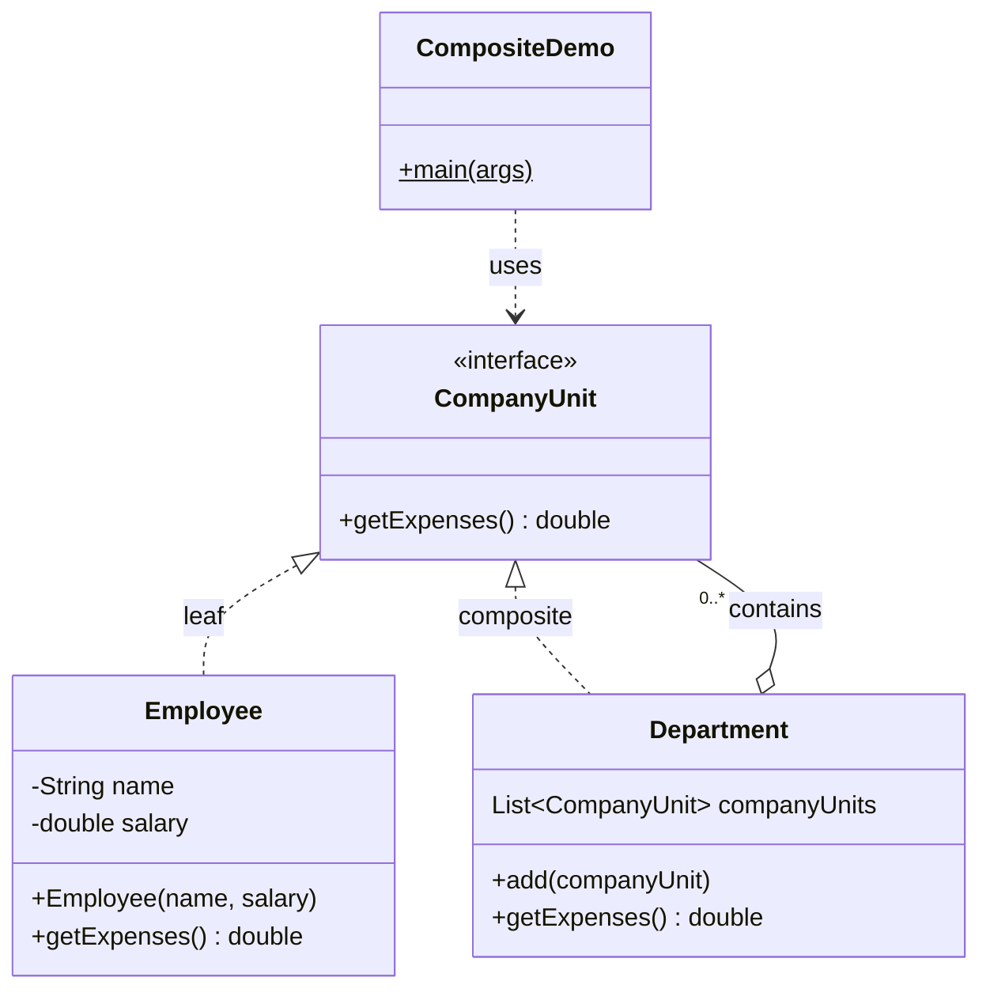
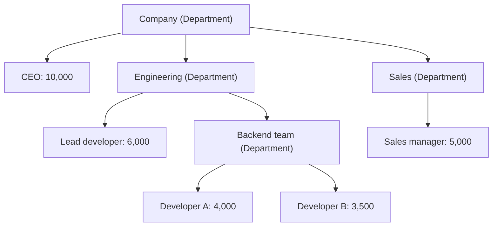
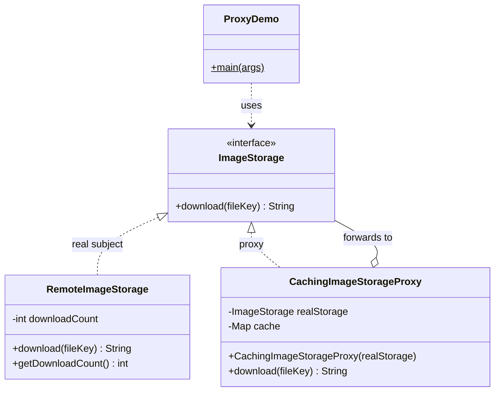
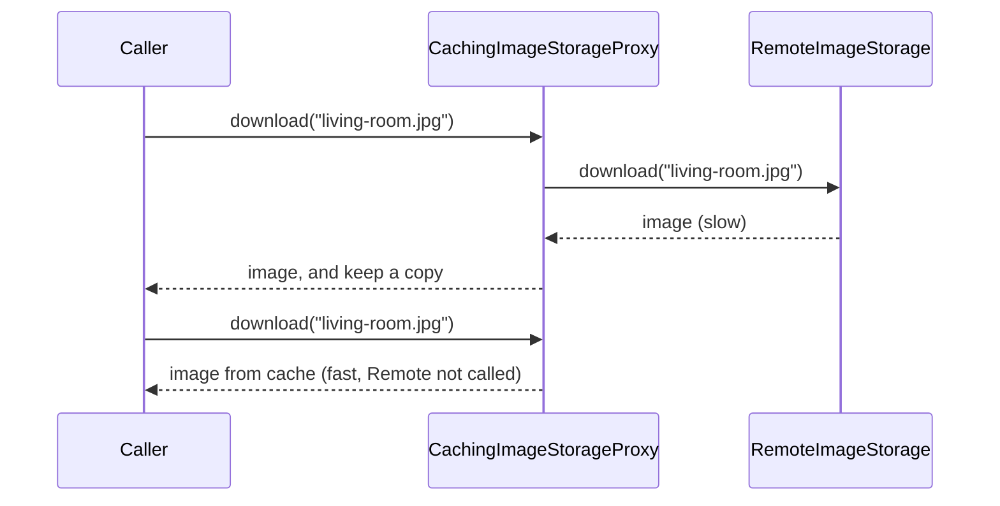
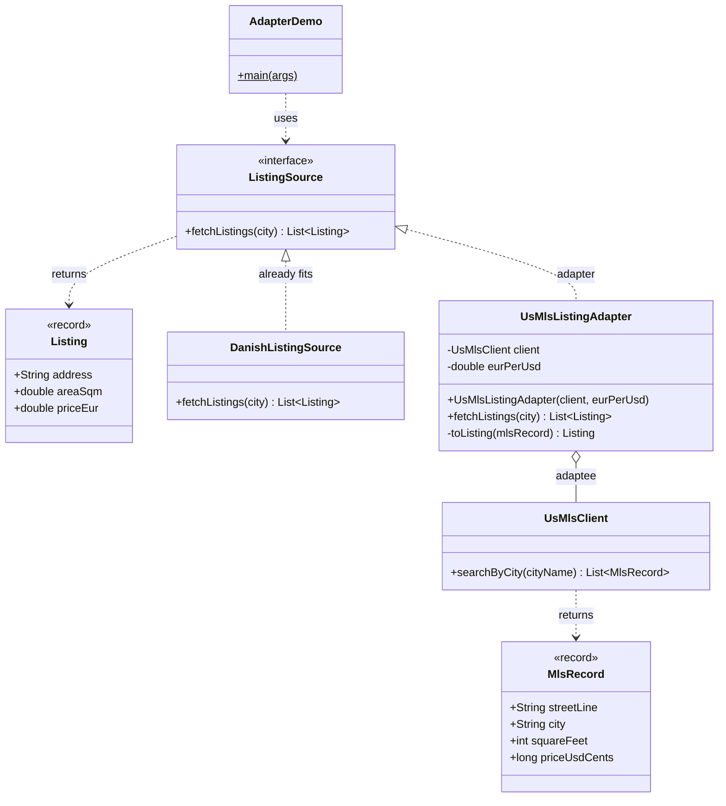
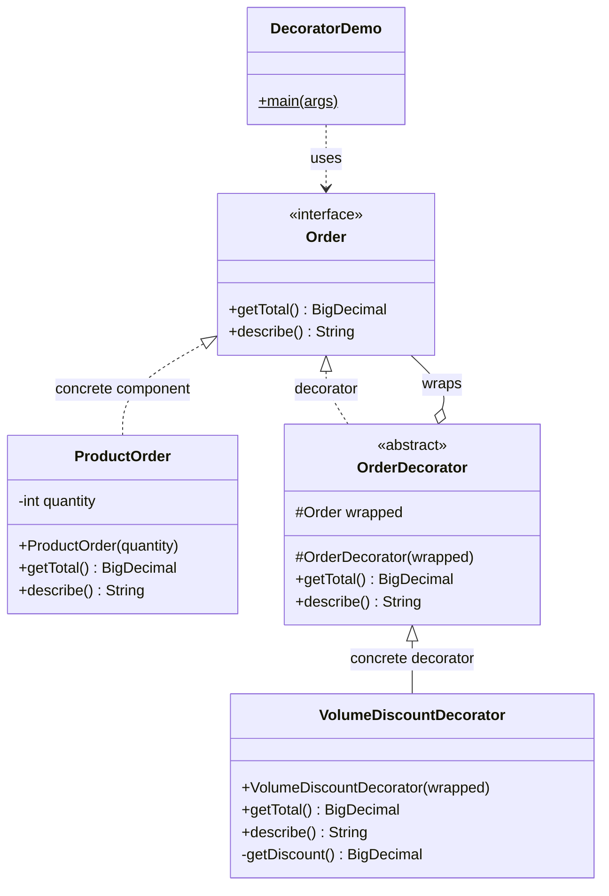
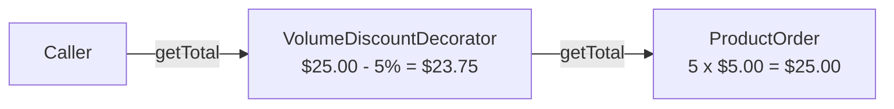
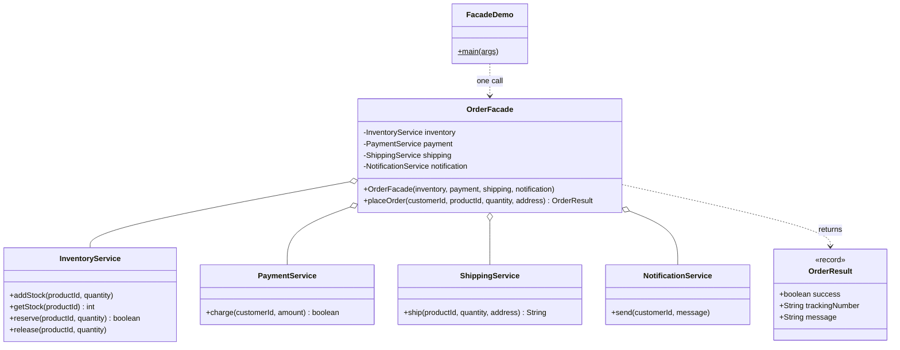
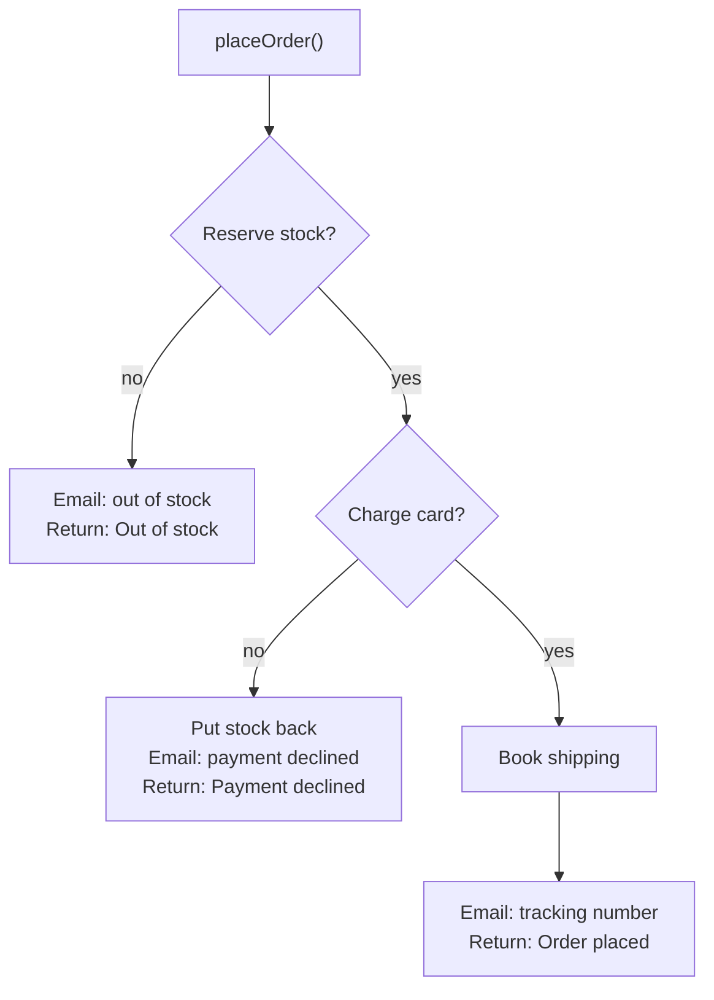

# Structure Pattern
1. Composite pattern: Treat a single object and a group of objects in the same way, by building them into a tree
2. Proxy pattern: Put a stand-in object in front of the real one, with the same interface, to control access to it (cache, lazy load, security check, logging)
3. Adapter pattern: Wrap a class whose interface does not fit, so it can be used through the interface your code expects
4. Decorator pattern: Wrap an object in another object with the same interface to add behaviour, without changing the original class
5. Facade pattern: Give one simple entry point to a group of classes, so callers do not need to know how they work together

The diagrams below use [Mermaid](https://mermaid.js.org/syntax/classDiagram.html). They render on GitHub and in most Markdown previews.

How to read the arrows:
- `<|..` a class implements an interface
- `o--` a class holds references to other objects
- `..>` a class creates or uses another class

---

## 1. Composite pattern

Code: `composite/`



The tree that `CompositeDemo` builds:



Output:

```
Developer A (employee)     4,000.00 EUR
Backend team               7,500.00 EUR
Engineering               13,500.00 EUR
Sales                      5,000.00 EUR
Company                   28,500.00 EUR
```

**How it works**

Think of a company org chart. To find what the company costs, you ask each department. Each department asks its people and its sub-departments, and adds up the answers. You ask a single person and a whole department the same question: "what do you cost?"

- `CompanyUnit` is the shared interface. Anything in the company tree answers `getExpenses()`.
- `Employee` is a **leaf**. It has no children and returns its own salary.
- `Department` is a **composite**. It holds a list of `CompanyUnit`s, which can be employees or other departments. Its `getExpenses()` loops over the list and adds up each child's answer.
- Because a department holds `CompanyUnit` and not `Employee`, departments can contain departments to any depth. The caller never checks which kind it has.
- To add a new kind of unit, such as a `Contractor` with a daily rate, you implement `CompanyUnit`. `Department` and the calling code don't change.

**When to use it:** your data is a tree (org charts, folders and files, menus and menu items, orders and order lines), and you want to run the same operation on one item or on a whole branch.

**Watch out:** the shared interface should contain only operations that make sense for both leaves and groups. Here `add()` lives only on `Department`, so no one can call `add()` on an `Employee` by mistake.

---

## 2. Proxy pattern

Code: `proxy/`



What happens on each download through the proxy:



Output of `ProxyDemo`, which runs the same four downloads twice:

```
Without proxy:
  [remote] downloading ORIGINAL/12-harbour-street/living-room.jpg ...
  [remote] downloading ORIGINAL/12-harbour-street/kitchen.jpg ...
  [remote] downloading ORIGINAL/12-harbour-street/living-room.jpg ...
  [remote] downloading ORIGINAL/12-harbour-street/living-room.jpg ...
  remote downloads: 4
With caching proxy:
  [remote] downloading ORIGINAL/12-harbour-street/living-room.jpg ...
  [remote] downloading ORIGINAL/12-harbour-street/kitchen.jpg ...
  [proxy]  cache hit for ORIGINAL/12-harbour-street/living-room.jpg
  [proxy]  cache hit for ORIGINAL/12-harbour-street/living-room.jpg
  remote downloads: 2
```

**How it works**

Think of a personal assistant who sits in front of a busy manager. You ask the assistant your question exactly as you would ask the manager. If the assistant already knows the answer, you get it straight away. If not, the assistant asks the manager, tells you, and remembers the answer for next time.

- `ImageStorage` is the shared interface. The caller only ever works with this.
- `RemoteImageStorage` is the **real subject**. It does the actual work, a slow download (simulated with a 200 ms wait).
- `CachingImageStorageProxy` is the **proxy**. It implements the same interface and holds a reference to the real storage. On the first request for a file it forwards the call and keeps the result. On later requests for that file it returns the stored copy and skips the real storage.
- The caller doesn't change. `ProxyDemo.run()` takes an `ImageStorage` and works the same with or without the proxy. You decide where to create the proxy, and the rest of the code doesn't know.

**Common kinds of proxy**

| Kind | What the proxy adds | Example |
|---|---|---|
| Caching proxy | Remembers results of expensive calls | This sample |
| Virtual proxy | Creates the real object only when it is first needed | Load a large image only when it is shown |
| Protection proxy | Checks permissions before forwarding | Only the file's owner may download it |
| Remote proxy | Hides a network call behind a local object | A REST or gRPC client stub |
| Logging proxy | Records each call before forwarding | Audit trail |

**When to use it:** you want to add control around an object (caching, a permission check, lazy creation, logging) without changing that object or its callers.

**Watch out:**
- This cache never empties and is not safe for many threads at once. A real cache needs a size or time limit, and a thread-safe map such as `ConcurrentHashMap`.
- In Spring you rarely write proxies by hand. `@Cacheable`, `@Transactional` and `@Async` work by wrapping your bean in a generated proxy.

**Proxy vs Decorator:** both wrap an object that has the same interface. A proxy controls *access* to the object, and usually creates or owns it. A decorator adds *new behaviour*, and decorators are often stacked on top of each other.

---

## 3. Adapter pattern

Code: `adapter/`



What the adapter translates:

| Our app (`ListingSource`, `Listing`) | US partner (`UsMlsClient`, `MlsRecord`) | Conversion in the adapter |
|---|---|---|
| `fetchListings(city)` | `searchByCity(cityName)` | Call the other method name |
| `address` | `streetLine` + `city` | Join with `", "` |
| `areaSqm` | `squareFeet` | × 0.09290304 |
| `priceEur` | `priceUsdCents` | ÷ 100, then × EUR/USD rate |

Output of `AdapterDemo`:

```
Copenhagen:
  Nyhavn 12, Copenhagen       85.0 m2   450,000.00 EUR
  Strøget 7, Copenhagen      120.0 m2   690,000.00 EUR
Boston:
  221 Baker Ave, Boston      111.5 m2   414,000.00 EUR
  10 Ocean Dr, Boston        232.3 m2 1,104,000.00 EUR
```

**How it works**

Think of a travel plug adapter. Your laptop charger has a European plug and the wall socket is American. You don't rewire the charger or the wall. You put a small adapter in between, and both sides stay as they are.

- `ListingSource` is the **target**: the interface our application expects. The report code in `AdapterDemo` only knows this interface.
- `DanishListingSource` already returns our `Listing` format, so it implements `ListingSource` directly.
- `UsMlsClient` is the **adaptee**: a third-party class we cannot change. Its method name is different, and it returns square feet and US cents.
- `UsMlsListingAdapter` is the **adapter**. It implements `ListingSource`, holds a `UsMlsClient`, and in `fetchListings()` it calls `searchByCity()` and converts each `MlsRecord` into a `Listing`.
- The report code reads Danish and US listings the same way. To add another partner, you write another adapter. The report code and the partner's client stay unchanged.

**When to use it:** you need to use an existing class (a third-party library, a legacy system, a partner API) but its interface or data format doesn't match what your code expects.

**Watch out:** keep the adapter to translation only. If it starts making business decisions, that logic is hidden in a place nobody expects. In this sample, the exchange rate is passed in from outside instead of being fixed in the adapter.

**Adapter vs Proxy:** a proxy has the *same* interface as the object it wraps and controls access to it. An adapter *changes* the interface so that something that doesn't fit can be used.

---

## 4. Decorator pattern

Code: `decorator/`

Business rule: the product costs $5 per unit. When the order total is more than $20, the client gets 5% off. An order of exactly $20 gets no discount.



How the objects are wrapped:



Output of `DecoratorDemo`:

```
Plain order:
  5 x $5.00 = $25.00
With volume discount:
  3 x $5.00 = $15.00 (no discount, total not over $20.00)
  4 x $5.00 = $20.00 (no discount, total not over $20.00)
  5 x $5.00 = $25.00 - 5% discount $1.25 = $23.75
  10 x $5.00 = $50.00 - 5% discount $2.50 = $47.50
```

**How it works**

Think of gift wrapping. The present inside stays the same. Each layer of wrapping adds something on the outside, and from the outside it is still "a present" you can hand over.

- `Order` is the **component** interface. Anything with a total price implements it.
- `ProductOrder` is the **concrete component**. It knows only the basic price: quantity × $5.
- `OrderDecorator` is the base **decorator**. It implements `Order` and holds another `Order` inside. By default it passes every call through.
- `VolumeDiscountDecorator` is a **concrete decorator**. It asks the wrapped order for its total, and if that is more than $20 it takes 5% off.
- `ProductOrder` is never changed. The discount is added from outside: `new VolumeDiscountDecorator(new ProductOrder(5))`. The caller still sees an `Order`.
- More rules can be stacked the same way. For example, a `TaxDecorator` could wrap the discounted order: `new TaxDecorator(new VolumeDiscountDecorator(new ProductOrder(5)))`. Each rule stays in its own small class.

**When to use it:** you want to add optional behaviour (discounts, taxes, fees, logging, compression) to an object, and pick or combine these at runtime, without changing the original class or making a subclass for every combination.

**Watch out:**
- Order matters when you stack decorators. "Discount then tax" and "tax then discount" can give different totals.
- Money uses `BigDecimal`, not `double`, so values like $23.75 stay exact.
- Java's own I/O classes use this pattern: `new BufferedReader(new InputStreamReader(inputStream))`.

**Decorator vs Proxy:** both wrap an object with the same interface. A decorator adds behaviour and is meant to be stacked. A proxy controls access to the object (cache, security, lazy loading).

---

## 5. Facade pattern

Code: `facade/`



What `placeOrder()` does behind the one call:



Output of `FacadeDemo`:

```
Successful order:
  [inventory] reserved 10 x PHOTO-PACK
  [payment]   charged $50.00 to alice
  [shipping]  10 x PHOTO-PACK to 12 Harbour Street, tracking TRK-1001
  [email]     to alice: Your order is on its way. Tracking: TRK-1001
  => Order placed (TRK-1001)
Out of stock (only 290 left):
  [email]     to bob: Sorry, PHOTO-PACK is out of stock.
  => Out of stock
Payment declined ($1,250 is over the $1,000 limit):
  [inventory] reserved 250 x PHOTO-PACK
  [payment]   declined $1250.00 for carol
  [inventory] released 250 x PHOTO-PACK
  [email]     to carol: Your payment of $1250.00 was declined.
  => Payment declined
Stock left: 290
```

**How it works**

Think of a hotel reception desk. You ask for a room, and the receptionist deals with housekeeping, billing and the key cards for you. You don't need to know who those people are or in what order to ask them.

- `InventoryService`, `PaymentService`, `ShippingService` and `NotificationService` are the **subsystem**. Each does one job and knows nothing about the others.
- `OrderFacade` is the **facade**. Its single method `placeOrder()` calls the services in the right order: reserve stock, charge the card, book shipping, send an email.
- The facade also handles the failure cases. If stock is short, nothing is charged. If the card is declined, the reserved stock is put back.
- `FacadeDemo` makes one call per order. It never talks to the four services directly, so the rules about their order live in one place.
- The services are still public. Code that needs something special, such as a stock report, can use `InventoryService` directly.

**When to use it:** a task needs several classes called in a fixed order, and you don't want every caller to repeat (and maybe get wrong) that sequence. A Spring `@Service` that coordinates several repositories and clients is usually a facade.

**Watch out:** a facade can grow into a "god class" that does everything. Keep each facade to one area, such as ordering, and keep the real work inside the subsystem classes.

**Facade vs Adapter:** an adapter makes *one* class fit an interface you already have. A facade creates a *new, simpler* interface over *several* classes.

---

## Proxy vs Decorator

The two patterns look the same in code. Both classes implement the same interface as the object they wrap, hold a reference to it, and forward calls to it. The difference is in **why** they wrap it.

```java
// Proxy (proxy/)
ImageStorage storage = new CachingImageStorageProxy(new RemoteImageStorage());

// Decorator (decorator/)
Order order = new VolumeDiscountDecorator(new ProductOrder(5));
```

| | Proxy | Decorator |
|---|---|---|
| Main purpose | Control **access** to the object | Add **behaviour** to the object |
| Question it answers | "Should this call reach the real object, and when?" | "What extra should happen on top of the result?" |
| Effect on the result | Same result as the real object. The caller shouldn't notice any difference except speed, security or logs | Changed or extended result. In our sample the total goes from $25.00 to $23.75 |
| Does it always call the wrapped object? | No. It may skip the call (cache hit, access denied) or delay it (lazy loading) | Yes, almost always. It calls the wrapped object, then adds its own part |
| Stacking | Usually one proxy per object | Made to be stacked: `new Tax(new Discount(new ProductOrder(5)))` |
| Who creates the wrapped object | Often the proxy itself, or the framework. The caller may not know a proxy exists | The caller, who picks which decorators to add, in which order |
| Can the caller choose to leave it out? | Usually not. It is put in place for the caller | Yes. Each decorator is an optional add-on |
| Typical uses | Caching, lazy loading, permission checks, remote calls, logging | Discounts, taxes, fees, formatting, compression, buffering |
| Sample in this project | `CachingImageStorageProxy`: a repeat download returns the saved copy and skips `RemoteImageStorage` | `VolumeDiscountDecorator`: always asks `ProductOrder` for its total, then takes off 5% |
| Java / Spring examples | Spring `@Cacheable`, `@Transactional`, `@Async`. Hibernate lazy-loaded entities. `java.lang.reflect.Proxy` | `BufferedReader(new InputStreamReader(...))`. `GZIPOutputStream(new FileOutputStream(...))` |

**A quick test:** ask what the wrapper changes.
- If it changes **whether, when or how** the real call happens, but not the answer, it is a **proxy**.
- If it changes **the answer itself** by adding something, it is a **decorator**.

Some wrappers sit between the two. A logging wrapper, for example, is called a proxy when it is generated for you, as with Spring AOP. It is called a decorator when you add it by hand as an optional layer. Use the name that best explains your intent to the next reader.
