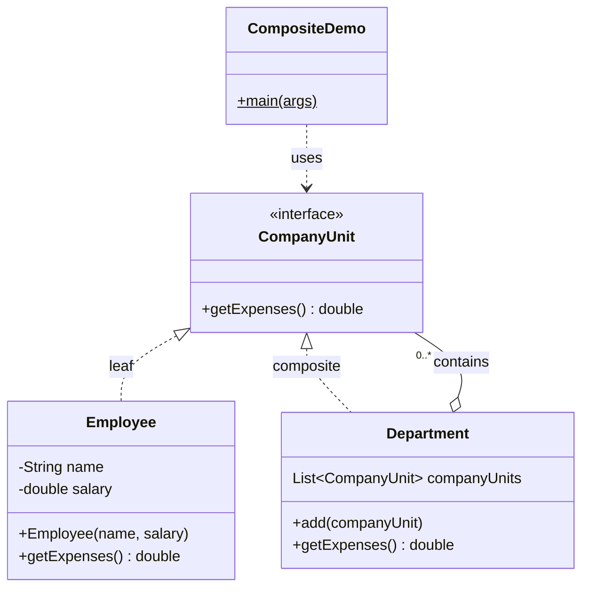
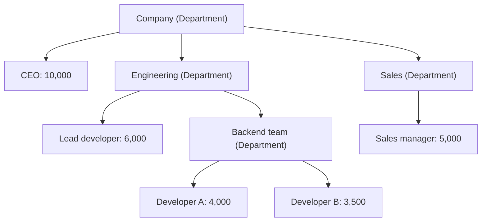
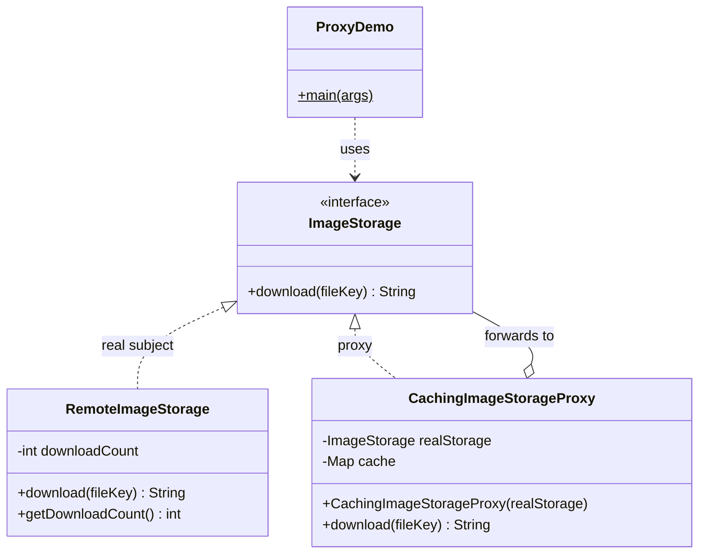
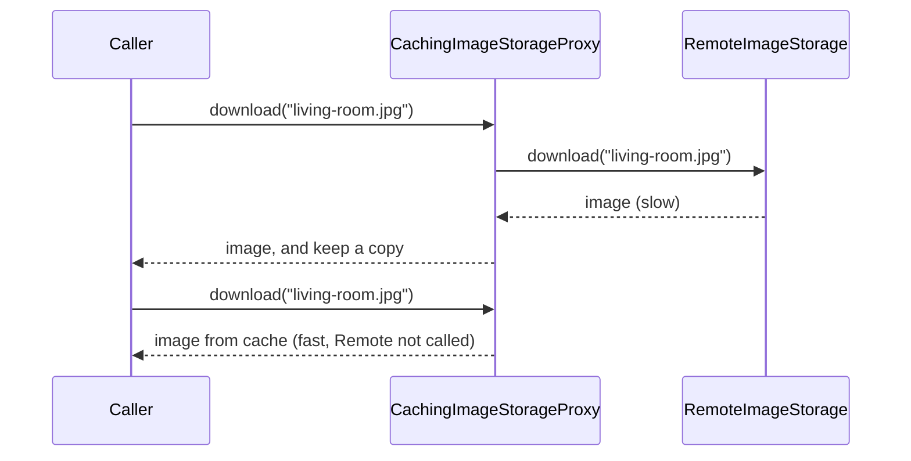

# Structure Pattern
1. Composite pattern: Treat a single object and a group of objects in the same way, by building them into a tree
2. Proxy pattern: Put a stand-in object in front of the real one, with the same interface, to control access to it (cache, lazy load, security check, logging)

The diagrams below use [Mermaid](https://mermaid.js.org/syntax/classDiagram.html). They render on GitHub and in most Markdown previews.

How to read the arrows:
- `<|..` a class implements an interface
- `o--` a class holds references to other objects
- `..>` a class creates or uses another class

---

## 1. Composite pattern

Code: `composite/`



The tree that `CompositeDemo` builds:



Output:

```
Developer A (employee)     4,000.00 EUR
Backend team               7,500.00 EUR
Engineering               13,500.00 EUR
Sales                      5,000.00 EUR
Company                   28,500.00 EUR
```

**How it works**

Think of a company org chart. To find what the company costs, you ask each department. Each department asks its people and its sub-departments, and adds up the answers. You ask a single person and a whole department the same question: "what do you cost?"

- `CompanyUnit` is the shared interface. Anything in the company tree answers `getExpenses()`.
- `Employee` is a **leaf**. It has no children and returns its own salary.
- `Department` is a **composite**. It holds a list of `CompanyUnit`s, which can be employees or other departments. Its `getExpenses()` loops over the list and adds up each child's answer.
- Because a department holds `CompanyUnit` and not `Employee`, departments can contain departments to any depth. The caller never checks which kind it has.
- To add a new kind of unit, such as a `Contractor` with a daily rate, you implement `CompanyUnit`. `Department` and the calling code don't change.

**When to use it:** your data is a tree (org charts, folders and files, menus and menu items, orders and order lines), and you want to run the same operation on one item or on a whole branch.

**Watch out:** the shared interface should contain only operations that make sense for both leaves and groups. Here `add()` lives only on `Department`, so no one can call `add()` on an `Employee` by mistake.

---

## 2. Proxy pattern

Code: `proxy/`



What happens on each download through the proxy:



Output of `ProxyDemo`, which runs the same four downloads twice:

```
Without proxy:
  [remote] downloading ORIGINAL/12-harbour-street/living-room.jpg ...
  [remote] downloading ORIGINAL/12-harbour-street/kitchen.jpg ...
  [remote] downloading ORIGINAL/12-harbour-street/living-room.jpg ...
  [remote] downloading ORIGINAL/12-harbour-street/living-room.jpg ...
  remote downloads: 4
With caching proxy:
  [remote] downloading ORIGINAL/12-harbour-street/living-room.jpg ...
  [remote] downloading ORIGINAL/12-harbour-street/kitchen.jpg ...
  [proxy]  cache hit for ORIGINAL/12-harbour-street/living-room.jpg
  [proxy]  cache hit for ORIGINAL/12-harbour-street/living-room.jpg
  remote downloads: 2
```

**How it works**

Think of a personal assistant who sits in front of a busy manager. You ask the assistant your question exactly as you would ask the manager. If the assistant already knows the answer, you get it straight away. If not, the assistant asks the manager, tells you, and remembers the answer for next time.

- `ImageStorage` is the shared interface. The caller only ever works with this.
- `RemoteImageStorage` is the **real subject**. It does the actual work, a slow download (simulated with a 200 ms wait).
- `CachingImageStorageProxy` is the **proxy**. It implements the same interface and holds a reference to the real storage. On the first request for a file it forwards the call and keeps the result. On later requests for that file it returns the stored copy and skips the real storage.
- The caller doesn't change. `ProxyDemo.run()` takes an `ImageStorage` and works the same with or without the proxy. You decide where to create the proxy, and the rest of the code doesn't know.

**Common kinds of proxy**

| Kind | What the proxy adds | Example |
|---|---|---|
| Caching proxy | Remembers results of expensive calls | This sample |
| Virtual proxy | Creates the real object only when it is first needed | Load a large image only when it is shown |
| Protection proxy | Checks permissions before forwarding | Only the file's owner may download it |
| Remote proxy | Hides a network call behind a local object | A REST or gRPC client stub |
| Logging proxy | Records each call before forwarding | Audit trail |

**When to use it:** you want to add control around an object (caching, a permission check, lazy creation, logging) without changing that object or its callers.

**Watch out:**
- This cache never empties and is not safe for many threads at once. A real cache needs a size or time limit, and a thread-safe map such as `ConcurrentHashMap`.
- In Spring you rarely write proxies by hand. `@Cacheable`, `@Transactional` and `@Async` work by wrapping your bean in a generated proxy.

**Proxy vs Decorator:** both wrap an object that has the same interface. A proxy controls *access* to the object, and usually creates or owns it. A decorator adds *new behaviour*, and decorators are often stacked on top of each other.
